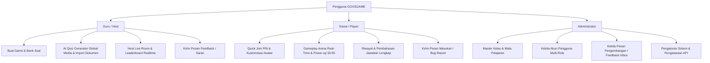
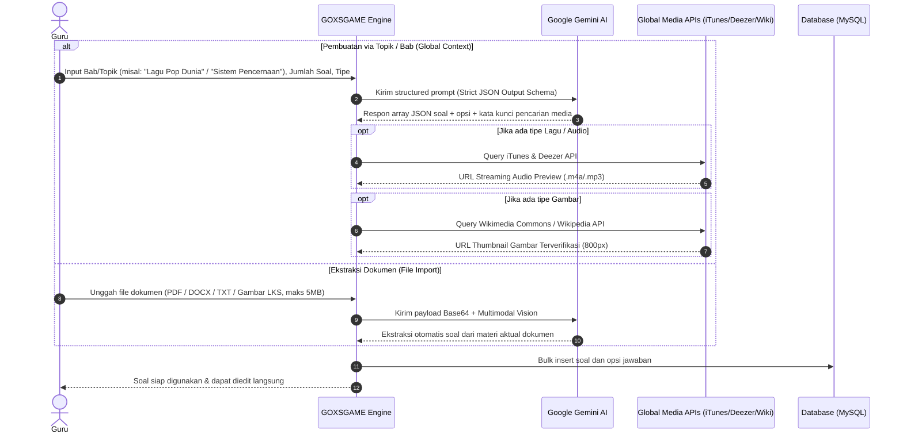
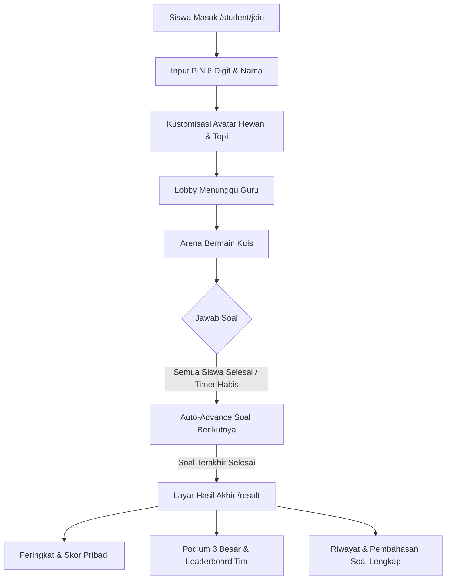
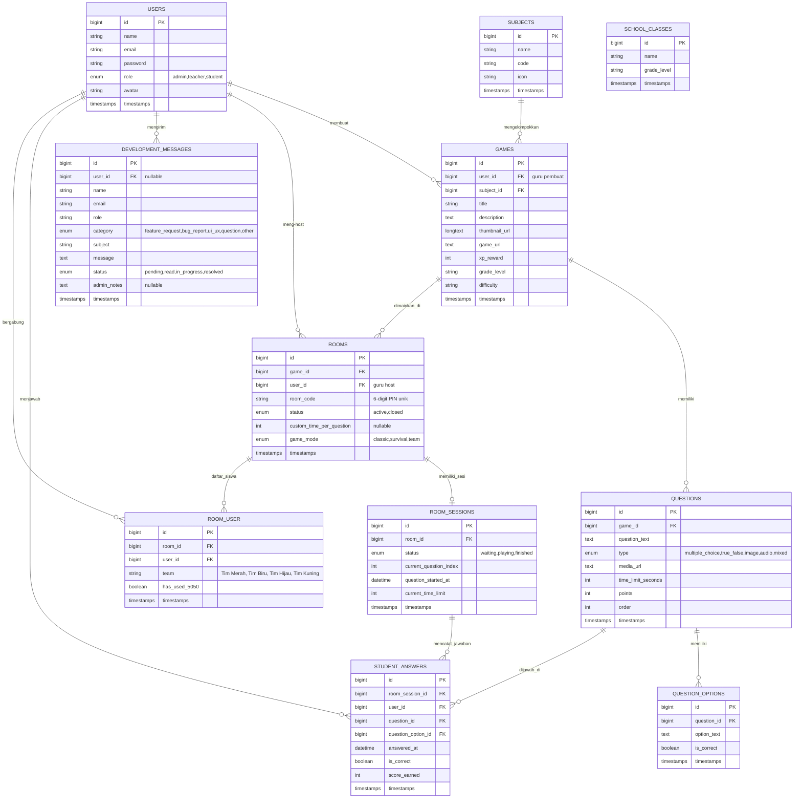

# Product Requirements Document (PRD) — GOXSGAME
**Platform Game Edukasi Interaktif Berbasis AI & Gamifikasi Kelas**  
*Versi: 2.5 | Status: Active Production Blueprint | Terakhir Diperbarui: Oktober 2026*

---

## 1. Eksekutif & Visi Produk

### 1.1 Visi
**GOXSGAME** adalah platform pembelajaran berbasis gamifikasi interaktif real-time yang dirancang khusus untuk merevolusi suasana kelas di Indonesia. Platform ini menggabungkan kemudahan pembuatan konten kuis otomatis bertenaga **Kecerdasan Buatan (Google Gemini AI)** dengan keseruan arena bermain multiplayer layaknya *Blooket* dan *Kahoot*, dibalut estetika visual modern **Neo-Brutalism**.

### 1.2 Tujuan Utama (Product Goals)
1. **Mengurangi Beban Guru (Zero-Friction Preparation)**:
   Memangkas waktu pembuatan kuis dari hitungan jam menjadi hitungan detik melalui AI Quiz Generator multi-tipe (Pilihan Ganda, Benar/Salah, Tebak Gambar, Tebak Lagu/Audio, Campuran) dan Document Parser multimodal (PDF, DOCX, TXT, Gambar). Alur pembuatan game otomatis mengarahkan guru langsung ke halaman kelola soal (*smart redirect*).
2. **Meningkatkan Keterlibatan Siswa (Maximum Engagement & Zero Idle Time)**:
   Menghilangkan kebosanan dan waktu tunggu kosong di kelas melalui:
   - **Auto-Advance Instan**: Soal otomatis langsung berganti begitu seluruh siswa aktif selesai menjawab tanpa harus menunggu sisa timer habis.
   - **Mode Permainan Variatif**: Klasik (akumulasi skor kecepatan), Survival (3 nyawa dengan eliminasi), dan Team Battle (4 tim warna).
   - **Power-Up & Efek Suara**: Bantuan 50:50, synthesizer audio prosedural in-browser, dan papan skor live.
3. **Mendukung Pembelajaran Tuntas (Mastery & Self-Review)**:
   Menyediakan **Riwayat & Pembahasan Soal Lengkap** di halaman akhir siswa (`/student/room/{room}/result`). Siswa dapat mengevaluasi jawaban mana yang benar, mana yang salah, dan langsung mengetahui kunci jawaban yang tepat beserta filter kategori interaktif.
4. **Desain Aksesibel & Responsif**:
   Tampilan berkontras tinggi dengan standar Neo-Brutalism, font modern (*Space Grotesk*, *Plus Jakarta Sans*, *JetBrains Mono*), dan dukungan penuh **Light & Dark Mode** dengan *floating theme toggle*.

---

## 2. Persona Pengguna (User Personas)



### 2.1 Guru (Host / Creator)
- **Karakteristik**: Guru SD, SMP, SMA, maupun pengajar bimbingan belajar.
- **Kebutuhan Utama**:
  - Membuat 5–20 soal berkualitas instan sesuai topik pelajaran kurikulum nasional maupun global (misal: "Sistem Pernapasan", "Tebak Lagu Pop Dunia", "Matematika Pecahan").
  - Unggah modul ajar (PDF/Word/TXT/Foto LKS) dan biarkan AI mengekstrak soal secara otomatis.
  - Membuka room permainan dengan kode PIN 6 digit atau tautan instan tanpa perlu mendaftarkan akun siswa secara manual.
  - Memantau live podium, distribusi skor tim, dan memajukan soal secara otomatis saat siswa sudah siap.
  - Mengirimkan masukan atau permintaan fitur langsung ke admin platform via halaman feedback.

### 2.2 Siswa (Player / Learner)
- **Karakteristik**: Siswa generasi digital yang menyukai visual interaktif, kompetisi ceria, dan umpan balik cepat.
- **Kebutuhan Utama**:
  - Masuk ke permainan dalam < 5 detik cukup dengan mengetik 6 digit PIN dan nama panggilan tanpa registrasi akun wajib (*guest mode*).
  - Kustomisasi avatar karakter hewan (9 jenis hewan x 7 aksesori topi/kacamata/mahkota).
  - Arena bermain responsif: efek suara synthesizer, indikator nyawa (mode survival), badge tim, dan power-up 50:50.
  - **Review Pembahasan Soal**: Begitu kuis selesai, siswa langsung bisa meninjau soal mana yang salah, apa jawaban yang mereka pilih, dan apa kunci jawaban yang benar untuk bahan belajar.

### 2.3 Administrator (System Manager)
- **Kebutuhan Utama**:
  - Mengelola data master mata pelajaran, jenjang kelas, dan akun guru/siswa.
  - Memantau dan menindaklanjuti pesan pengembangan (*feedback inbox*) dari guru & siswa dengan status alur kerja (`pending` -> `read` -> `in_progress` -> `resolved`).
  - Menjaga keandalan kuota API AI dengan multi-model failover dan simulasi fallback.

---

## 3. Arsitektur Teknologi & Infrastruktur

| Komponen | Spesifikasi & Teknologi Terkini |
| :--- | :--- |
| **Backend Framework** | **Laravel 13 (PHP 8.4)** dengan MVC Architecture, Eloquent ORM, dan Laravel Boost |
| **Frontend Stack** | Blade Templates, Vanilla Tailwind CSS v3, Alpine.js, Google Fonts (*Space Grotesk*, *Plus Jakarta Sans*, *JetBrains Mono*) |
| **Ikonografi** | Google Material Symbols Outlined |
| **Database** | MySQL (Production/Staging) / SQLite (Local automated test suite) |
| **Mesin AI** | Google Gemini Generative AI (`gemini-2.5-flash`, `gemini-1.5-flash`, `gemini-2.0-flash`) via `config('services.gemini.api_key')` dengan Multi-Model Failover & Simulasi Fallback Cerdas |
| **Mesin Audio & Suara** | **Web Audio API Synthesizer** (Nada prosedural C5-E5-G5 untuk Benar, buzzer untuk Salah, sweep untuk Eliminasi) + BGM Toggle bawaan |
| **Integrasi Media Global** | **iTunes Search API & Deezer API** (Cuplikan lagu global & nasional resolusi tinggi), **Wikipedia & Wikimedia Commons API** (Gambar edukatif terverifikasi), QR Code Generator |
| **Realtime Engine** | HTTP Polling Sinkron Efisien (~1.5s - 1.8s) dengan Row-Level Locking (`lockForUpdate`) untuk konsistensi konkurensi data |
| **Keamanan Rute Game** | Pengecualian CSRF selektif terproteksi pada rute real-time game dan penanganan *auto-recovery* TokenMismatchException 419 di `bootstrap/app.php` |
| **Desain UI/UX** | Neo-Brutalism Design System dengan tema ganda cerdas (Light Mode & Dark Mode) |

---

## 4. Modul & Spesifikasi Fitur Lengkap

### 4.1 Modul Autentikasi & Otorisasi (Multi-Role RBAC)
- **Role Hierarchy**:
  - `admin`: Akses penuh ke seluruh menu, master mapel, master kelas, manajemen pengguna, pengaturan sistem, dan inbox feedback pengembangan.
  - `teacher`: Dashboard guru, pembuatan bank game, peracikan soal AI, host room permainan, dan live control panel.
  - `student`: Dashboard siswa, akses cepat PIN room, arena bermain kuis, dan review hasil evaluasi.
  - `guest`: Siswa anonim yang bergabung instan via PIN tanpa kewajiban pendaftaran akun di awal.
- **Keamanan & Desain**:
  - Password hashing (Bcrypt), proteksi brute-force (`throttle`), dan stacking context aman (`z-index: 10`) pada form input password.

### 4.2 Modul Bank Game & Manajemen Soal
- **Entitas Game**:
  - Judul, deskripsi, thumbnail otomatis, URL game, reward XP (+100 s/d +500 XP), mata pelajaran, dan tingkat kesulitan.
  - **Smart Redirect**: Setelah guru membuat atau mengedit data game, sistem langsung mengarahkan guru ke halaman kelola soal (`/manage/games/{game}/questions`) sehingga guru tidak bingung mencari menu penambahan soal.
- **Tipe Soal yang Didukung**:
  1. **Pilihan Ganda (`multiple_choice`)**: 4 pilihan jawaban dengan 1 kunci jawaban benar.
  2. **Benar / Salah (`true_false`)**: Evaluasi biner cepat dengan tombol visual hijau/merah.
  3. **Tebak Gambar (`image`)**: Dilengkapi gambar edukatif otomatis dari Wikimedia Commons.
  4. **Tebak Lagu & Suara (`audio`)**: Pemutar audio terintegrasi cuplikan resmi (iTunes/Deezer/Wikimedia) untuk lagu daerah hingga musik internasional global (misal: Taylor Swift, Queen, dll.).
  5. **Campuran (`mixed`)**: Kombinasi variatif gambar, audio, dan teks dalam satu sesi kuis.
- **Pengaturan Waktu & Skor**: Waktu fleksibel per soal (15s, 30s, 45s, 60s) atau kustom per room, dengan skor berbobot akurasi dan kecepatan menjawab.

### 4.3 Modul AI Quiz Generator & Document Parsing



- **Fitur Kunci AI**:
  - **Pencarian Media Global Kontekstual**: AI Generator tidak dibatasi oleh topik lokal/daerah semata; pencarian media otomatis menyesuaikan topik secara global.
  - **Auto-Failover Multi-Model**: Sistem otomatis berpindah model jika terjadi limit kuota atau HTTP 503 (*High Demand*).
  - **Simulasi Fallback Anti-Crash**: Jika jaringan AI offline, sistem secara cerdas membuat soal simulasi terstruktur agar kegiatan belajar mengajar di kelas tidak pernah terhenti.

### 4.4 Modul Room Management & Host Control Panel
- **Pilihan Mode Permainan**:
  1. **Mode Klasik (🎯)**: Akumulasi skor kecepatan dan ketepatan tertinggi tanpa pinalti eliminasi.
  2. **Mode Survival (☠️)**: Setiap siswa memiliki 3 nyawa (❤️). Jawaban salah mengurangi 1 nyawa; 3 kali salah mengakibatkan eliminasi dari kuis.
  3. **Mode Team Battle (🤝)**: Siswa dibagi secara seimbang ke dalam 4 tim (*Tim Merah, Tim Biru, Tim Hijau, Tim Kuning*); skor diakumulasikan per tim.
- **Mekanisme Auto-Advance Soal Pintar**:
  - Sesi permainan menggunakan method `checkAndAutoAdvance()` dengan transaksi aman berkonkurensi tinggi (`lockForUpdate`).
  - **Otomatis Pindah Seketika**: Begitu **seluruh siswa aktif** telah menjawab soal aktif saat itu, kuis langsung berganti ke soal berikutnya tanpa harus menunggu sisa hitungan timer habis.
  - **Toleransi Survival**: Siswa yang telah gugur/tereliminasi pada mode Survival otomatis dikecualikan dari daftar tunggu aktif.
  - **Toleransi Disconnect**: Jika ada siswa yang pasif atau koneksi terputus, soal akan tetap berganti secara otomatis ketika sisa waktu timer mencapai $0$ detik.
- **Live Leaderboard Host**:
  - Interval polling diperbarui setiap 1.8 detik; halaman guru otomatis menyinkronkan tampilan saat nomor soal berpindah.

### 4.5 Modul Siswa: Quick Join, Gameplay Arena, & Riwayat Pembahasan



- **Akses Cepat (Zero-Barrier Join)**:
  - Input 6 digit PIN (kapital otomatis) dan nama panggilan.
  - **Avatar Creator**: 9 hewan dasar (🐮, 🐴, 🐐, 🐷, 🐻, 🦊, 🐰, 🐶, 🐱) x 7 aksesori unik (🧢, 🕶️, 🪖, 👑, 🎩, 🎓, 🎀).
- **Arena Permainan Interaktif**:
  - Soal kontras tinggi, pemutar audio/gambar, countdown timer, dan tombol jawaban warna-warni 3D membal.
  - **Power-up 50:50**: Siswa dapat mengeliminasi 2 opsi salah (1x pakai per game).
  - **Synthesizer Suara Built-in**: Audio responsif saat jawab benar/salah/eliminasi tanpa jeda buffer file eksternal.
- **Riwayat & Pembahasan Soal Lengkap (`#riwayat-soal`)**:
  - Ditampilkan langsung di halaman hasil akhir siswa setelah menyelesaikan kuis.
  - **Statistik Evaluasi**: Ringkasan persentase akurasi (🎯), jumlah jawaban benar (✓), salah (✕), dan tidak terjawab/kosong (⏰).
  - **Tab Filter Cepat**: Filter kartu soal berdasarkan `Semua`, `Benar`, `Salah`, dan `Kosong`.
  - **Evaluasi Tiap Soal**:
    - Nomor soal, teks soal, tipe soal, dan audio replay/gambar preview.
    - Opsi pilihan siswa ditandai secara tegas (hijau jika benar, merah jika salah).
    - Kunci jawaban yang benar selalu disorot dengan badge `✓ KUNCI JAWABAN BENAR` agar siswa dapat langsung belajar dari kesalahan.

### 4.6 Modul Sistem Feedback / Pesan Pengembangan
- Menjembatani komunikasi dua arah antara pengguna di kelas dengan tim administrator:
  - **Siswa & Guru (`/feedback`)**: Formulir pengiriman saran, masukan UI/UX, dan laporan kendala teknis beserta riwayat status tiket pribadi.
  - **Admin (`/manage/feedback`)**: Panel manajemen untuk meninjau masukan, mengubah status alur kerja (`pending` -> `read` -> `in_progress` -> `resolved`), dan menambahkan catatan tindak lanjut admin.

---

## 5. Design System & Spesifikasi UI/UX

### 5.1 Gaya Desain: Neo-Brutalism Edukatif
- **Border Tebal Konsisten**: `border: 3px solid #000000` atau `border: 4px solid #000000`.
- **Sudut Lengkung Modern**: `rounded-xl` (12px), `rounded-2xl` (16px), hingga `rounded-3xl` (24px).
- **Hard Drop Shadow**: `box-shadow: 3px 3px 0px #000000` hingga `6px 6px 0px #000000` tanpa efek blur.
- **Mikro-interaksi Membal (*Bouncy Interaction*)**:
  - Tombol normal: `shadow-[4px_4px_0px_#000]`.
  - Hover: `translate-y-[-2px] shadow-[6px_6px_0px_#000]`.
  - Active: `translate-y-[2px] shadow-[0px_0px_0px_#000]`.

### 5.2 Palet Warna & Token Desain

| Token Desain | Nilai Hex | Penggunaan Utama | Aturan Kontras Teks |
| :--- | :--- | :--- | :--- |
| **Brand Primary Blue** | `#2563EB` | Latar tema terang, tombol navigasi, badge ranking | Teks Putih (`#FFFFFF`) |
| **Cyber Yellow** | `#FFE600` | Kartu juara 1, tombol aksi utama, badge pilihan | **Wajib Teks Hitam Pekat (`#000000 !important`)** |
| **Success Green** | `#4ADE80` | Indikator benar, tombol Mulai/Join, status aktif | **Wajib Teks Hitam Pekat (`#000000 !important`)** |
| **Coral Pink** | `#FB7185` | Mode Survival, indikator salah, badge eliminasi | **Wajib Teks Hitam Pekat (`#000000 !important`)** |
| **Electric Cyan** | `#06B6D4` | Tag versi, tombol info AI, aksen sekunder | **Wajib Teks Hitam Pekat (`#000000 !important`)** |
| **Electric Purple** | `#A855F7` | Live Leaderboard header, badge mapel, feedback | Teks Putih (`#FFFFFF`) |
| **Dark Canvas (Dark)** | `#0F172A` | Background body saat Dark Mode | Teks Slate Terang / Putih |
| **Dark Card (Dark)** | `#1E293B` | Wadah kartu utama saat Dark Mode | Teks Slate Terang / Putih |
| **Dark Inner / Input** | `#0F172A` | Kolom isian input form saat Dark Mode | Teks Putih Bersih |

### 5.3 Aturan Universal Kontras & Tema Ganda
1. **Aturan Kontras Mutlak**:
   Elemen berwarna latar cerah (`#FFE600`, `#4ADE80`, `#FB7185`, `#06B6D4`) **DILARANG BERTEKS PUTIH**. Harus selalu menggunakan teks hitam pekat (`#000000`) di tema Terang maupun Gelap.
2. **Floating Theme Toggle**:
   Tersedia tombol mengambang di pojok kanan atas halaman publik (*Student Join & Waiting*) dan di navbar dashboard untuk beralih mode Light & Dark secara instan tanpa reload halaman.
3. **Proteksi Stacking Context Form**:
   Kontainer ikon pada form input wajib memiliki class `.relative > .pointer-events-none { z-index: 10; }` agar ikon tidak tertutup saat input difokuskan (`translateY(3px)`).

---

## 6. Model Data & Skema Basis Data Aktual



---

## 7. Persyaratan Non-Fungsional (NFR)

1. **Performa & Waktu Muat**:
   - Waktu muat halaman awal < 1.2 detik pada jaringan 4G standar.
   - Respon polling gameplay siswa < 80ms melalui endpoint terindeks ringan (`/student/room/{room}/state`).
   - Ekstraksi dan peracikan AI selesai dalam waktu < 10 detik dengan indikator animasi loading.
2. **Keandalan & Skalabilitas Game Loop**:
   - Mampu menangani hingga 50–100 siswa aktif bermain serentak dalam satu room kuis.
   - Penggunaan transaksi row-level locking (`lockForUpdate`) untuk mencegah *race condition* saat banyak siswa men-submit jawaban di milidetik yang sama.
3. **Resiliensi AI & Fallback**:
   - Perlindungan anti-crash berlapis: multi-model failover otomatis jika model utama mengalami HTTP 503/429, serta template simulasi otomatis jika seluruh koneksi AI eksternal offline.
4. **Kompatibilitas & Aksesibilitas**:
   - 100% responsif pada layar smartphone (360px), tablet, Chromebook, hingga proyektor kelas (1080p/4K).
   - Mendukung penuh browser modern (Google Chrome, Mozilla Firefox, Safari, Microsoft Edge).
5. **Kualitas Kode & Standar Pengujian**:
   - 100% lulus uji otomatis PHPUnit Feature Tests untuk alur game session, otorisasi, dan review hasil.
   - Kode PHP terformat rapi sesuai standar resmi Laravel Pint (`vendor/bin/pint --format agent`).

---

## 8. Status Implementasi & Roadmap Pengembangan

```mermaid
gantt
    title Roadmap Status Rilis GOXSGAME
    dateFormat  YYYY-MM
    section Fondasi & Core
    Multi-Role RBAC & Master Data      :done, des1, 2026-08, 2026-09
    Neo-Brutalism Design & Dark Mode   :done, des2, 2026-08, 2026-09
    section Gameplay & Host Engine
    Game Modes (Classic, Survival, Team):done, g1, 2026-09, 2026-10
    Power-up 50:50 & Web Audio Synthesizer:done, g2, 2026-09, 2026-10
    Auto-Advance Instan Semua Siswa    :done, g3, 2026-10, 2026-10
    section Evaluasi & AI Lanjutan
    Riwayat & Pembahasan Soal Siswa    :done, e1, 2026-10, 2026-10
    Pencarian Media Global iTunes/Wiki :done, e2, 2026-10, 2026-10
    Sistem Pesan Pengembangan (Feedback):done, e3, 2026-10, 2026-10
    section Tahap Selanjutnya
    Ekspor Rekap Nilai Excel / PDF Guru:active, n1, 2026-11, 2026-12
    Mode Latihan Mandiri (Solo Practice):n2, 2026-11, 2026-12
    WebSocket Zero-Latency Engine      :n3, 2026-12, 2027-01
```

### Fitur yang Sudah Selesai & Berjalan di Production (Status: Done ✅)
- [x] **Autentikasi & Multi-Role Guard** (Admin, Guru, Siswa, Guest).
- [x] **Design System Neo-Brutalism** dengan kontras tinggi & tema ganda (Light / Dark Mode).
- [x] **Bank Game & CRUD Soal** dengan *smart redirect* langsung ke halaman kelola soal setelah simpan.
- [x] **AI Quiz Generator & Document Parser** dengan pencarian media global konteks (iTunes/Deezer untuk audio, Wikipedia/Wikimedia untuk gambar).
- [x] **Host Control Panel & 3 Mode Permainan**: Mode Klasik, Mode Survival (3 Nyawa), dan Mode Team (4 Tim Warna).
- [x] **Mekanisme Auto-Advance Soal Pintar**: Otomatis berpindah saat seluruh siswa aktif selesai menjawab maupun saat timer habis.
- [x] **Gameplay Siswa Interaktif**: Quick Join PIN, Avatar hewan & aksesori, power-up 50:50, dan synthesizer suara.
- [x] **Riwayat & Pembahasan Soal Lengkap**: Siswa dapat meninjau soal, melihat opsi yang mereka pilih (benar/salah), melihat kunci jawaban benar, filter kategori interaktif, dan audio replay.
- [x] **Sistem Pesan Pengembangan (Feedback)**: Kanal komunikasi guru/siswa dengan admin.

### Tahap Pengembangan Selanjutnya (Next Horizon 🎯)
- [ ] **Ekspor Rekapitulasi Nilai Kelas (Excel & PDF)**: Laporan evaluasi kuis yang dapat diunduh guru untuk arsip nilai kurikulum.
- [ ] **Mode Latihan Mandiri (*Solo Self-Paced Practice*)**: Siswa dapat memainkan kuis secara mandiri di luar sesi kelas untuk persiapan ujian.
- [ ] **WebSocket Push Protocol (Laravel Reverb / Pusher)**: Opsi koneksi socket langsung untuk skala ratusan peserta tanpa beban polling HTTP.

---
*Dokumen ini merupakan pedoman resmi pengembangan sistem GOXSGAME versi 2.5. Setiap perubahan arsitektur, penambahan endpoint, maupun perancangan antarmuka wajib merujuk pada standar dan kontrak teknis dalam PRD ini.*
